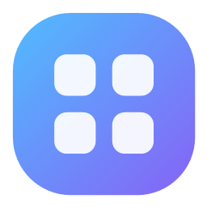
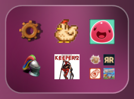
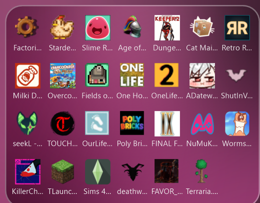
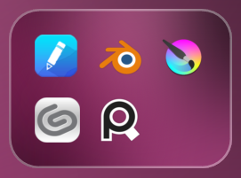
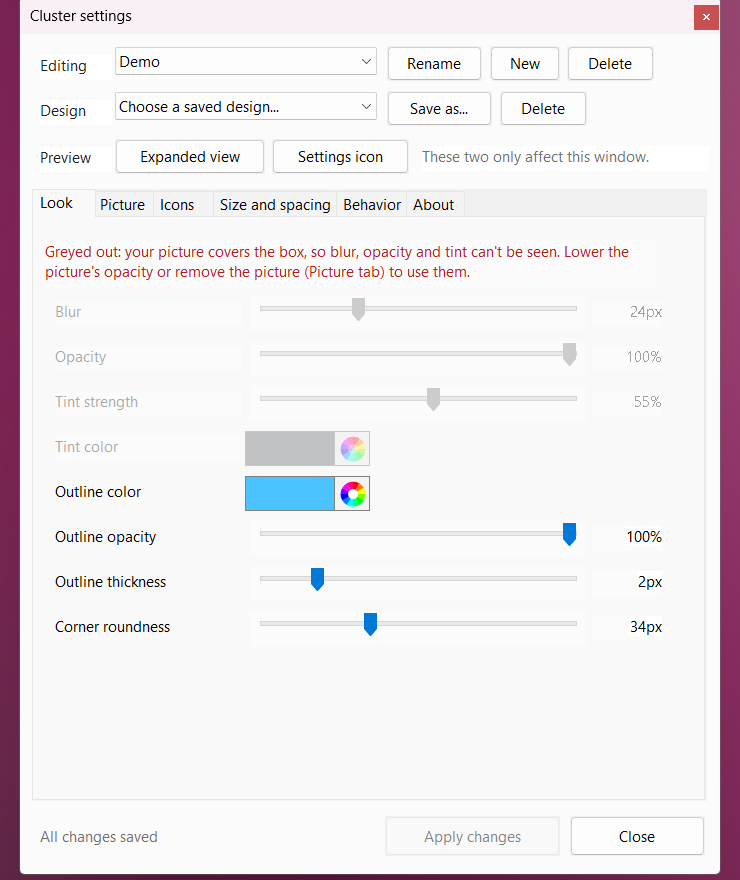

<p align="center">
  
</p>

<h1 align="center">ClusterWidget</h1>

<p align="center">
  Group your desktop shortcuts into small blurred, fully customizable boxes that open on click.<br>
  A tiny native Windows 11 app: 0% CPU while idle, about 2 MB, no installer.
</p>

<p align="center">
  <a href="../../releases/latest"><b>Download</b></a> &middot;
  <a href="https://notkazhons.github.io/ClusterWidget/"><b>Website</b></a> &middot;
  <a href="docs/CONFIG.md"><b>Config reference</b></a> &middot;
  <a href="CHANGELOG.md"><b>Changelog</b></a>
</p>

<p align="center">
  
  
  
</p>

## Why

Desktops fill up with shortcuts. A **cluster** is a small box that shows a few of them (like a phone folder) and opens
to show the rest. It sits on your desktop like part of the wallpaper, stays visible when you press Win+D, and costs
nothing while you are not using it.

- **Looks like it belongs:** blurred wallpaper, tint, outline and corners you control, or your own picture.
- **Light:** a Native AOT executable of about 2 MB. No timers run while idle (measured 0% CPU), roughly 11-14 MB of
  memory per cluster.
- **As many clusters as you like**, each with its own icons, position and look.
- **Saved designs:** keep a look under a name and apply it to any cluster.

## Install

1. Download `ClusterWidget-<version>-win-x64.zip` from the [Releases](../../releases) page.
2. Unzip it anywhere (for example `C:\Tools\ClusterWidget`) and run `ClusterWidget.exe`.
3. Drop shortcuts, folders or programs onto the box that appears. Right-click it for settings.

Windows 11 (x64). The app is not code-signed, so Windows SmartScreen may warn the first time: choose *More info*, then *Run anyway*.
To start it with Windows, turn on *Start with Windows* (Settings, Behavior tab). To remove it, delete the folder and
`%APPDATA%\ClusterWidget`.

## Using it

| You want to | Do this |
|---|---|
| Open a cluster | Click it (Esc or click elsewhere closes it) |
| Add an icon | Drop a file, folder, program or shortcut on it |
| Move it | Drag the box. It snaps to your desktop icon grid unless you turn that off |
| Re-order icons | Open it and drag an icon onto another slot, or use A to Z in settings |
| Open settings | Hover the cluster and click the small gear, or right-click, or use the tray icon |
| Remove an icon | Right-click the icon |
| Add another cluster | Right-click, *New cluster* (it appears in the middle of the screen) |

Hover any icon for its name and location, and hover any setting for an explanation.

## Customizing

The settings window changes things live. **Apply changes** keeps them, **Cancel** (or Esc) undoes everything since your
last Apply.

<p align="center"></p>

- **Look:** blur, opacity, tint, outline (color, opacity, thickness) and corner roundness.
- **Picture:** a background picture with opacity, a second *overlay* color over it, zoom and position.
- **Icons:** an automatic grid or an exact *icons per row x column*, mini preview or plain last icon, whether a click
  opens the app or the cluster, sorting.
- **Size and spacing:** icon size, name size, padding (box edge to icons) and spacing (between icons), separately for
  the closed and expanded view, plus presets.
- **Behavior:** snap to grid, expand from the center or the top-left corner, settings icon position and size, start
  with Windows, *Use this look as my default*.
- **About:** how everything works, built into the app.

A **design** is a saved look and layout (not icons or position). Save one with *Save as...* at the top and apply it to
any cluster. *Use this look as my default* makes it the starting look of new clusters and what *Reset* returns to.

## Your files

Everything lives in `%APPDATA%\ClusterWidget` and is plain JSON you can edit while the app runs:

```
clusters\*.json      one file per cluster (icons, position, look)
designs\*.json       saved designs
shortcuts\           copies of .lnk / .url files you dropped, so deleting the original is safe
pictures\            copies of background pictures you chose
default-design.json  your default look (optional)
```

Colors are `#AARRGGBB` or `#RRGGBB`. See [docs/CONFIG.md](docs/CONFIG.md) for every key.

## How it works (short version)

- Each cluster is a layered window drawn with GDI+ and owned by the desktop window, which is why it stays put
  when you show the desktop with Win+D.
- The wallpaper does not change while a cluster sits on it, so the blur is computed once and reused. That makes blur
  strength, corner radius and opacity free sliders instead of a fixed system effect, and keeps idle cost at zero.
- Icons come from the same shell image list the desktop uses, at your Windows desktop icon size.

## Build from source

You need the [.NET 10 SDK](https://dotnet.microsoft.com/download) and the Visual Studio C++ build tools
("Desktop development with C++"), because Native AOT links with the MSVC linker.

```powershell
dotnet test tests\ClusterWidget.Tests     # layout unit tests
.\tools\dev.ps1                           # publish to .\publish and start it
.\tools\package.ps1                       # build the release zip in .\dist
```

`tools\perf.ps1` runs isolated copies through stress scenarios (hundreds of icons, many clusters, huge icons, pictures)
and reports CPU, memory and frame times. Set `CLUSTERWIDGET_DIR=<folder>` to run a copy with its own settings, and
`CLUSTERWIDGET_PERF=<file>` to log timings.

## Known limits

- Windows 11 has no desktop-widget API, so a cluster is a window that lives just above the desktop. It cannot blur
  other windows, only the wallpaper.
- The process is system-DPI-aware like the desktop itself, so a monitor with a different scale than the primary one is
  bitmap-scaled.
- A cluster shows as many icons as fit on the screen when expanded.
- A wallpaper slideshow is picked up the next time Windows reports a display or setting change.
- If a program is moved or deleted, its icon becomes an empty square: remove it or drop it again.

## Contributing

Bug reports and pull requests are welcome, see [CONTRIBUTING.md](CONTRIBUTING.md). Release notes are in
[CHANGELOG.md](CHANGELOG.md).

## License

[MIT](LICENSE)
